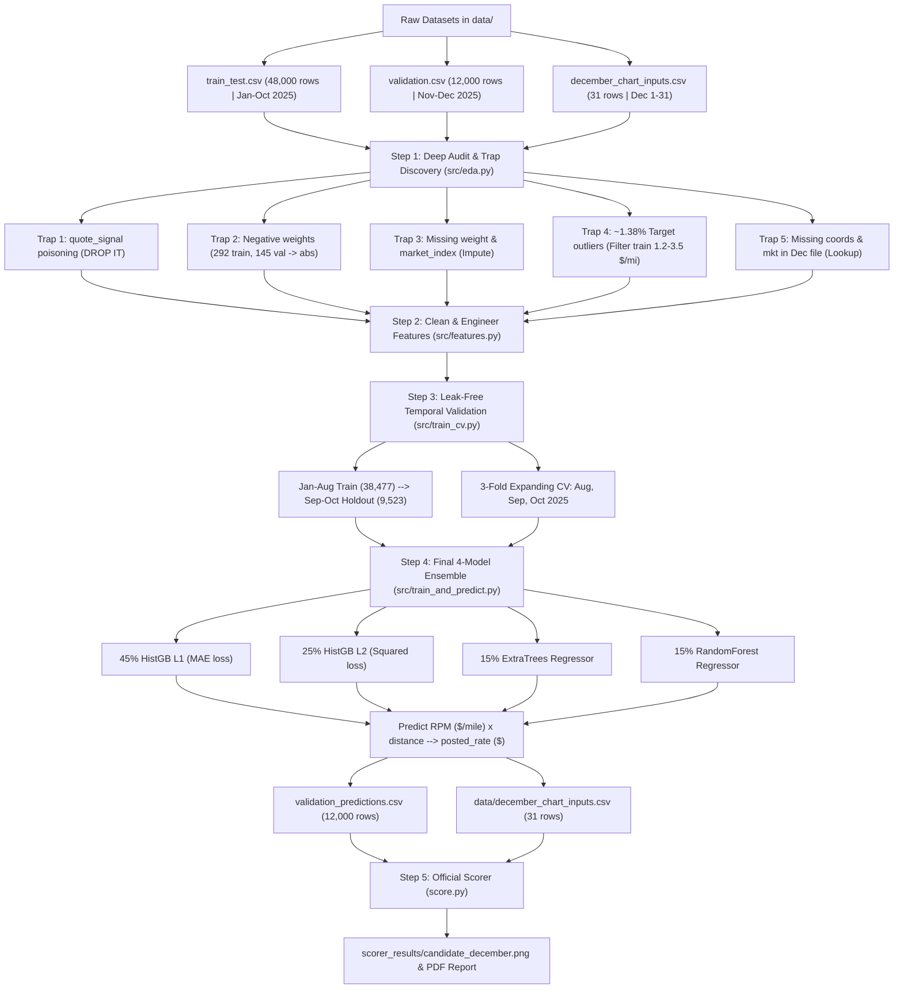
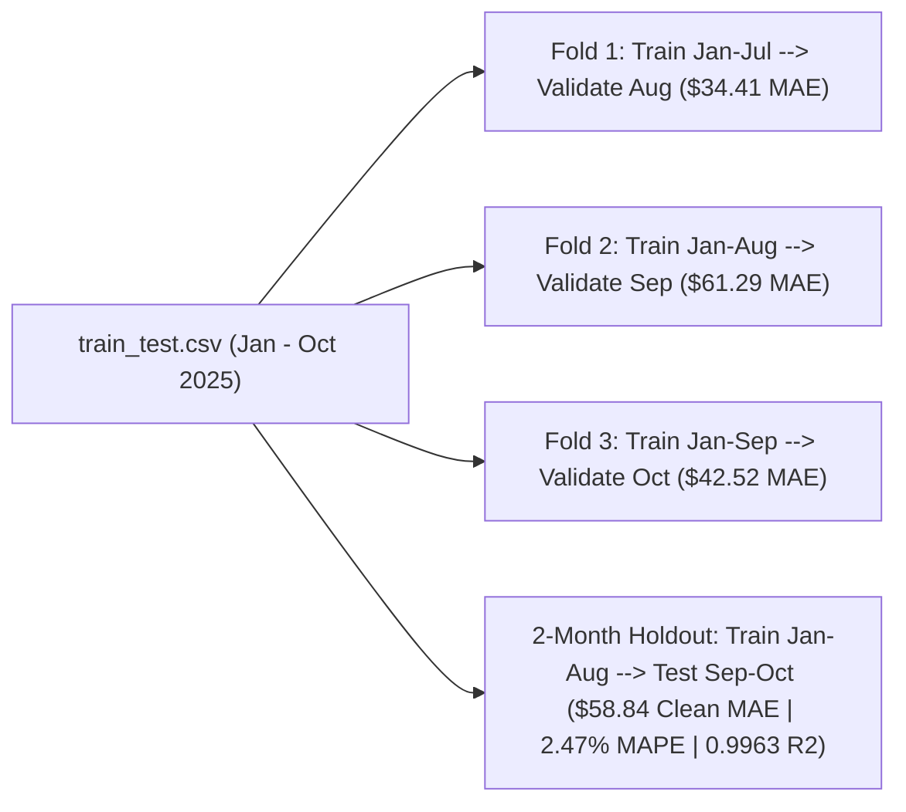

# 🧠 Spotter AI Freight Rate ML — Visual Workflow & Architecture Guide

> **Purpose:** Yeh guide specifically tere samajhne aur interview/Loom walkthrough ke liye banayi gayi hai — taaki ek nazar me poora flow (`Data ──▶ Traps Caught ──▶ Cleaning ──▶ Features ──▶ Validation ──▶ Ensemble ──▶ Output`) crystal clear ho jaye!

---

## 🗺️ 1. End-to-End Pipeline Visual Flowchart



---

## 📦 2. Data Kahan Se Aaya Aur Problem Kya Thi?

```text
Spotter AI Email Zip
   ├── data/train_test.csv                  ──▶ 48,000 loads (Jan 1 – Oct 31, 2025) [Target: posted_rate]
   ├── data/validation.csv                  ──▶ 12,000 loads (Nov 1 – Dec 31, 2025) [Predict karna hai]
   ├── data/validation_predictions_template ──▶ 12,000 blank rows (TE-000001 .. TE-012000)
   └── data/december_chart_inputs.csv       ──▶ 31 days (Dec 1 – Dec 31, Fixed lane: Lexington -> Fort Wayne, 360 mi, Dry Van, 32,000 lb)
```

**Core Question:**  
Trucking me agar hume pata ho ki load kahan se kahan ja raha hai (`pickup` ──▶ `delivery`), kitna door hai (`distance`), weight (`weight`), truck type (`equipment`: Dry Van / Reefer / Flatbed), aur date/market (`date`, `market_index`), toh **freight rate (`posted_rate` in `$`)** kitna hoga?

---

## 🕵️ 3. Humne Bugs & Hidden Traps Kaise Pakde (Aur Solve Kiye)?

```text
[1] quote_signal Trap (SABSE BADA DISCOVERY!)
    ├── Jan, Feb, Mar, Jun, Sep ──▶ quote_signal ≈ real RPM (+0.45 to +0.49 corr)  [Looks like magic!]
    ├── Apr, May, Jul, Oct      ──▶ quote_signal INVERTED (-0.43 to -0.47 corr)    [Ulta ho gaya!]
    ├── Aug + ALL Nov-Dec Val   ──▶ Pure random white noise (~2.05 mean, 0.00 corr) [Dead weight!]
    └── December Chart Inputs   ──▶ Column hi gayab hai!
    ✅ FIX: DROP quote_signal completely! (Holdout MAE dropped: $156.51 ──▶ $114.62)

[2] Negative & Missing Weight Bug
    ├── 292 rows (Train) + 145 rows (Val) ──▶ Negative weight (e.g. -36,559 lb, min -47,500 lb)
    ├── 300 rows (Train) + 165 rows (Val) ──▶ Missing (NaN)
    └── ✅ FIX (src/features.py):
          weight_clean = abs(weight) + is_weight_negative flag + equipment median fill

[3] Missing market_index & Regime Shift
    ├── 374 rows (Train) + 249 rows (Val) ──▶ Missing (NaN)
    ├── Within-day std sirf ~0.025 hai (Matlab poori date ka ek macro market tightness number hai!)
    ├── Train median = 1.06  ──▶  Validation (Nov-Dec) median = 0.92 (Market thanda hua!)
    └── ✅ FIX: Impute missing market_index strictly using same-day median from allowed fold data

[4] Corrupted Target Outliers (~1.38% rows)
    ├── ~0.7% rows < $1.00/mile (e.g. 2,536 mi sirf $846 = $0.33/mi!)
    ├── ~0.7% rows > $4.50/mile (e.g. 314 mi = $4,445 = $14.13/mi!)
    └── ✅ FIX: Filter training targets strictly to [1.2, 3.5] $/mi (Validation/Holdout par KABHI filter nahi lagaya!)

[5] Incomplete Schema in December Chart CSV
    ├── december_chart_inputs.csv me pickup_lat/lon, delivery_lat/lon, aur market_index nahi the!
    └── ✅ FIX:
          ├── build_city_coord_lookup() ──▶ Lexington (36.99152, -84.99876) -> Fort Wayne (41.31561, -85.36206)
          └── build_daily_market_lookup() ──▶ Dec 1..31 daily market_index (0.833 on Dec 1 -> 1.045 on Dec 25!)
```

---

## ⚙️ 4. Relations & Features Kaise Banaye (`src/features.py`)

Humne raw columns se model-friendly **trucking domain features** banaye:

```text
Raw Inputs
   │
   ├──▶ Distance Math       ──▶ distance, log_distance, sqrt_distance, inv_distance (1/dist)
   ├──▶ GPS Coordinates     ──▶ haversine_miles (straight-line)
   │                        ──▶ circuity_ratio (road detour factor = distance / haversine)
   │                        ──▶ detour_miles, bearing_sin, bearing_cos (East-West vs North-South corridor)
   ├──▶ Cleaned Load Specs  ──▶ weight_clean, weight_k, is_heavy_load (>= 40k lb), equipment
   ├──▶ Market & Scale      ──▶ market_index_clean, market_x_dist, weight_x_dist
   └──▶ Calendar & Holidays ──▶ month, day, dayofweek, dayofyear, is_weekend, is_month_end
                            ──▶ dow_sin/cos, doy_sin/cos, days_to_holiday
```

### 💡 Sabse Smart Idea: Direct `$` Nahi, **`RPM ($/mile)`** Predict Karo!

```text
Kyun?
  ├── 100-mile trip ka rate ~$300 hota hai; 2,800-mile trip ka ~$5,500.
  ├── Direct dollar predict karne par bade trips ka error model ko dominate karta hai (Clean MAE = $73.09).
  └── Jab hum target = (posted_rate / distance) yaani $/mile banate hain:
         Model $/mile predict karta hai ──▶ predicted_rate = predicted_rpm * distance
         Result: Clean MAE seedha $73.09 ──▶ $58.84 par gir gaya!
```

---

## 🧪 5. Temporal Validation & Leak-Free Architecture (`src/train_cv.py` & `src/train_and_predict.py`)



* **Zero Leakage Rule:**
  1. **No Random Split:** Kyunki actual test set future (Nov–Dec) hai, random shuffle se future leak hota. Isliye strictly past ──▶ future time split use kiya.
  2. **Inside-Fold Fitting Only:** `weight` medians, `daily_market_lookup`, outlier filtering (`[1.2, 3.5]`), aur smoothed target encoding (`pickup_te_rpm`, `delivery_te_rpm`, `lane_te_rpm`, `eq_band_te_rpm`) **sirf training fold (`df_t`)** par fit kiye gaye.

---

## 🏆 6. Model Tournament & Final 4-Model Ensemble

| Model | Sep–Oct Holdout Clean MAE | Clean MAPE | Clean R² | Verdict |
| :--- | :---: | :---: | :---: | :--- |
| Naive HistGB WITH `quote_signal` | `$102.90` *(All `$156.51`)* | — | — | ❌ Poisoned trap |
| Ridge Regression Baseline | `$147.46` | `7.03%` | `0.9720` | ❌ Underfits non-linearities |
| Hybrid Ridge + HistGB Residuals | `$86.23` | — | `0.9930` | ⚠️ Seasonal bias `+$84.97` |
| HistGB L1 (Clean Direct Rate) | `$73.09` | `2.97%` | `0.9896` | ⚠️ High variance on long hauls |
| HistGB L1 (Clean `RPM * dist`) | `$61.16` | `2.54%` | `0.9914` | ✅ Huge jump from RPM target |
| **Final 4-Model Ensemble (`RPM * dist`)** | **`$58.84`** | **`2.47%`** | **`0.9963`** | 🏆 **Winner (`45% HistGB L1 + 25% HistGB L2 + 15% ET + 15% RF`)** |

---

## 📂 7. Har File Ka Role (Quick Cheat Sheet)

* [src/eda.py](file:///Users/mangal777/Mangal/06_Prex/spotter_ml_assessment/src/eda.py) ──▶ Data check karne ke liye (nulls, negative weights, `quote_signal` drift, RPM outliers)
* [src/features.py](file:///Users/mangal777/Mangal/06_Prex/spotter_ml_assessment/src/features.py) ──▶ Data cleaning + 31 domain features + December coordinate/market lookups
* [src/train_cv.py](file:///Users/mangal777/Mangal/06_Prex/spotter_ml_assessment/src/train_cv.py) ──▶ Model comparison tournament (Ridge vs RF vs ET vs HistGB vs Poisoned Trap)
* [src/train_and_predict.py](file:///Users/mangal777/Mangal/06_Prex/spotter_ml_assessment/src/train_and_predict.py) ──▶ 3-fold expanding CV + full ensemble training + `validation_predictions.csv` & `data/december_chart_inputs.csv`
* [score.py](file:///Users/mangal777/Mangal/06_Prex/spotter_ml_assessment/score.py) ──▶ Spotter official validator ──▶ creates `scorer_results/candidate_december.png`
* [src/build_report.py](file:///Users/mangal777/Mangal/06_Prex/spotter_ml_assessment/src/build_report.py) ──▶ Builds `reports/Spotter_ML_Assessment_Report_Mangal_Soren.pdf`
* [LOOM_WALKTHROUGH_SCRIPT.md](file:///Users/mangal777/Mangal/06_Prex/spotter_ml_assessment/LOOM_WALKTHROUGH_SCRIPT.md) ──▶ 2.5-minute camera-on speaking script
