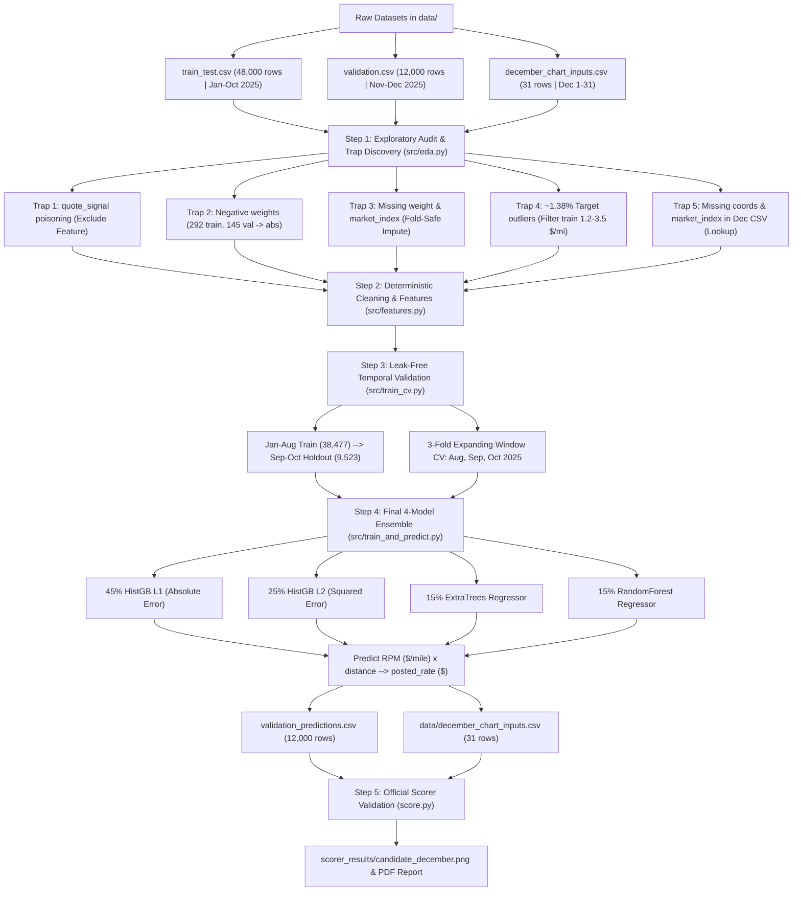
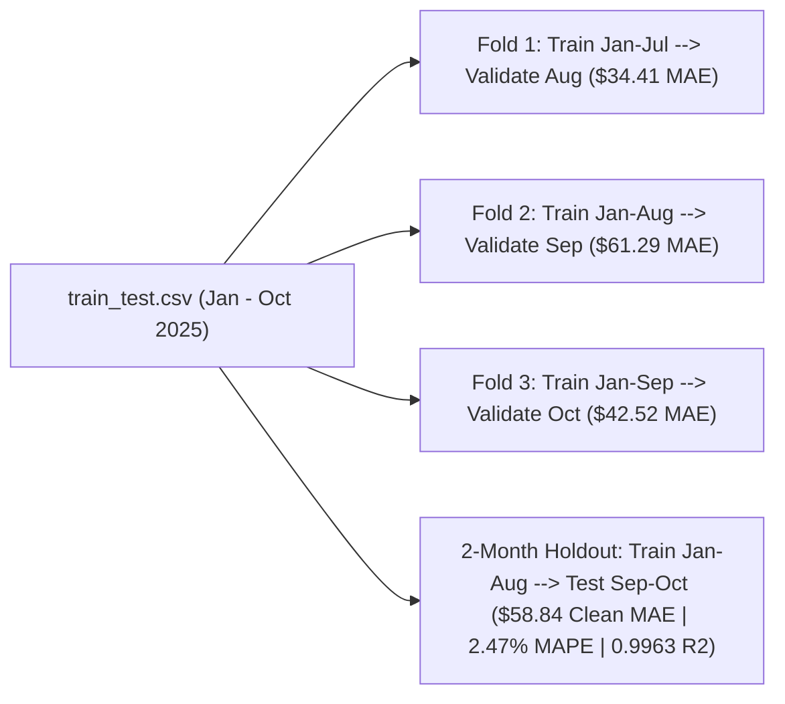

# Spotter AI Freight Rate ML — Architecture & Workflow Guide

A visual end-to-end walkthrough of the data pipeline, upstream anomaly traps discovered during EDA, feature engineering choices, temporal validation strategy, and model architecture.

---

## 1. End-to-End Pipeline Architecture



---

## 2. Dataset Overview & Problem Framing

```text
Spotter AI Provided Files
   ├── data/train_test.csv                    ──▶ 48,000 labeled loads (Jan 1 – Oct 31, 2025) [Target: posted_rate]
   ├── data/validation.csv                    ──▶ 12,000 unlabeled loads (Nov 1 – Dec 31, 2025) [Predict 12,000 rates]
   ├── data/validation_predictions_template   ──▶ 12,000 template rows (TE-000001 .. TE-012000)
   └── data/december_chart_inputs.csv         ──▶ 31 daily slots (Dec 1 – Dec 31: Lexington -> Fort Wayne, 360 mi, Dry Van, 32,000 lb)
```

**Core Objective:**  
Given origin/destination cities and coordinates, haul distance, load weight, equipment type (`Dry Van`, `Reefer`, `Flatbed`), date, and daily `market_index`, predict the truckload spot rate (`posted_rate` in USD) accurately on unseen future months (Nov–Dec 2025).

---

## 3. Data-Quality Traps Identified & Mitigations

```text
[1] quote_signal Upstream Poisoning (Critical Discovery)
    ├── Jan, Feb, Mar, Jun, Sep ──▶ Closely tracks actual RPM (+0.45 to +0.49 corr)  [Deceptively strong in random CV]
    ├── Apr, May, Jul, Oct      ──▶ Sign-inverted (-0.43 to -0.47 corr)              [Opposite relationship]
    ├── Aug + ALL Nov-Dec Val   ──▶ Uncorrelated white noise (~2.05 mean, ~0.00 corr)[Dry Van = Reefer = 2.05]
    └── december_chart_inputs   ──▶ Column is completely omitted
    ✅ Mitigation: Exclude quote_signal entirely. Holdout MAE dropped immediately from $156.51 ──▶ $114.62.

[2] Negative & Missing Load Weights
    ├── 292 rows (Train) + 145 rows (Val) ──▶ Corrupted negative values (e.g. -36,559 lb, min -47,500 lb)
    ├── 300 rows (Train) + 165 rows (Val) ──▶ Missing values (NaN)
    └── ✅ Mitigation (src/features.py):
          Recover abs(weight), add binary flags (is_weight_negative, is_weight_missing),
          and impute missing weights using equipment-specific training medians.

[3] Missing market_index & Macro Regime Shift
    ├── 374 rows (Train) + 249 rows (Val) ──▶ Missing values (NaN)
    ├── Within-day standard deviation is ~0.025 (acts as a daily macro tightness signal across lanes)
    ├── Train median = 1.06  ──▶  Validation (Nov-Dec) median = 0.92
    └── ✅ Mitigation: Impute missing market_index strictly using same-day medians inside allowed fold bounds.

[4] Corrupted Target Outliers (~1.38% of Training Loads)
    ├── ~0.7% rows < $1.00/mile (e.g. 2,536 mi at $846 = $0.33/mi)
    ├── ~0.7% rows > $4.50/mile (e.g. 314 mi at $4,445 = $14.13/mi)
    └── ✅ Mitigation: Restrict training target to [1.2, 3.5] $/mi (~98.6% clean mass) and train with L1/RPM objectives.
          (Holdout and validation rows are NEVER filtered during evaluation; both ALL and CLEAN metrics are reported.)

[5] Incomplete Schema in december_chart_inputs.csv
    ├── Missing pickup_lat, pickup_lon, delivery_lat, delivery_lon, and market_index
    └── ✅ Mitigation:
          ├── build_city_coord_lookup() ──▶ Maps Lexington (36.99152, -84.99876) & Fort Wayne (41.31561, -85.36206)
          └── build_daily_market_lookup() ──▶ Populates Dec 1..31 daily market_index (0.833 on Dec 1 -> 1.045 on Dec 25)
```

---

## 4. Feature Engineering & Target Formulation (`src/features.py`)

```text
Raw Inputs
   │
   ├──▶ Distance Transforms  ──▶ distance, log_distance, sqrt_distance, inv_distance (1 / distance)
   ├──▶ Spatial Geometry     ──▶ haversine_miles (great-circle distance)
   │                         ──▶ circuity_ratio (road detour factor = distance / haversine_miles)
   │                         ──▶ detour_miles, bearing_sin, bearing_cos (directional freight corridors)
   ├──▶ Load Characteristics ──▶ weight_clean, weight_k, is_heavy_load (>= 40,000 lb), equipment
   ├──▶ Scale Interactions   ──▶ market_index_clean, market_x_dist, weight_x_dist
   └──▶ Calendar & Holidays  ──▶ month, day, dayofweek, dayofyear, is_weekend, is_month_end
                             ──▶ dow_sin/cos, doy_sin/cos, is_holiday, days_to_holiday
```

### Why Predicting Rate-Per-Mile (`RPM`) Beats Direct Rate Modeling

```text
Problem with direct posted_rate ($):
  ├── 100-mile loads average ~$300 while 2,800-mile loads average ~$5,500.
  ├── Variance scales strongly with haul distance (heteroscedasticity), causing large errors on long hauls.
  └── Switching target to rate_per_mile = posted_rate / distance:
         Model predicts $/mile ──▶ final_rate = predicted_rpm * distance
         Impact: Cut Sep-Oct Holdout Clean MAE from $73.09 down to $58.84 (2.47% MAPE, 0.9963 R²).
```

---

## 5. Leak-Free Temporal Validation Strategy (`src/train_cv.py` & `src/train_and_predict.py`)



* **Zero Data Leakage Guarantees:**
  1. **Strict Out-of-Time Splits:** Because `validation.csv` spans Nov–Dec 2025, random K-fold splits leak future seasonal regimes. All model selection relied strictly on past-to-future splits.
  2. **Inside-Fold Fitting Only:** Weight medians, daily `market_index` lookups, outlier filtering (`[1.2, 3.5]`), and smoothed historical target encodings (`pickup_te_rpm`, `delivery_te_rpm`, `lane_te_rpm`, `eq_band_te_rpm`) are fit strictly within each training fold.

---

## 6. Model Comparison & Final Ensemble

| Model | Sep–Oct Holdout Clean MAE | Clean MAPE | Clean R² | Notes |
| :--- | :---: | :---: | :---: | :--- |
| Naive HistGB WITH `quote_signal` | `$102.90` *(All `$156.51`)* | — | — | Fails under Nov–Dec feature poisoning |
| Ridge Regression Baseline | `$147.46` | `7.03%` | `0.9720` | Underfits non-linear lane/equipment curves |
| Hybrid Ridge + HistGB Residuals | `$86.23` | — | `0.9930` | Seasonal trend overfits Jan–Aug (`+$84.97` bias) |
| HistGB L1 (Clean Direct Rate) | `$73.09` | `2.97%` | `0.9896` | Higher variance across long-haul distances |
| HistGB L1 (Clean `RPM * dist`) | `$61.16` | `2.54%` | `0.9914` | Major gain from RPM target formulation |
| **Final 4-Model Ensemble (`RPM * dist`)** | **`$58.84`** | **`2.47%`** | **`0.9963`** | **Selected (`45% HistGB L1 + 25% HistGB L2 + 15% ET + 15% RF`)** |

---

## 7. Repository Map

* [src/eda.py](src/eda.py) ──▶ Exploratory audit (nulls, negative weights, `quote_signal` drift, RPM distribution)
* [src/features.py](src/features.py) ──▶ Deterministic cleaning, spatial/calendar feature engineering, and December lookups
* [src/train_cv.py](src/train_cv.py) ──▶ Temporal holdout tournament across linear, bagging, and boosting baselines
* [src/train_and_predict.py](src/train_and_predict.py) ──▶ 3-fold expanding CV, diagnostic plots, final ensemble training, and inference
* [score.py](score.py) ──▶ Official Spotter AI scorer validating `validation_predictions.csv` and generating `scorer_results/candidate_december.png`
* [src/build_report.py](src/build_report.py) ──▶ Generates `reports/Spotter_ML_Assessment_Report_Mangal_Soren.pdf`
